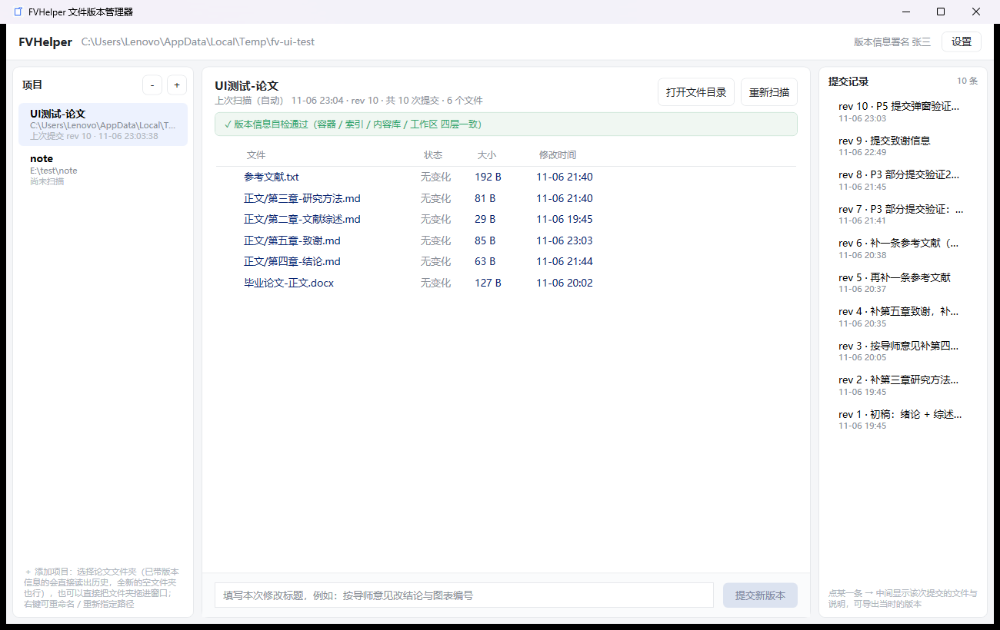
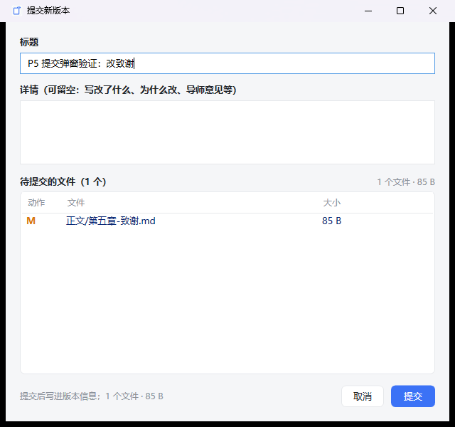
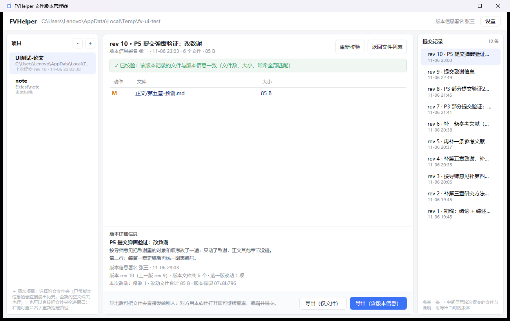
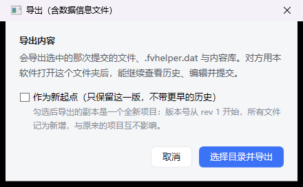
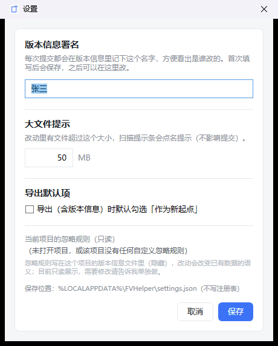

# FVHelper 文件版本管理器 · 用户手册

> 版本 v0.1-preview ｜ 手册版本 2026-11-06 ｜ 适用系统 Windows 10 1809+ / Windows 11（x64）
>
> 本手册按"能照着做完"的目标写：前三章看完就能上手，后面是查手册用的细节与排错。全部内容为 Markdown 单文件，可直接转成网页（见 §17）。

---

## 目录

1. [这是什么工具](#1-这是什么工具)
2. [安装与启动](#2-安装与启动)
3. [五分钟上手](#3-五分钟上手)
4. [界面导览](#4-界面导览)
5. [项目管理](#5-项目管理)
6. [扫描与改动识别](#6-扫描与改动识别)
7. [提交新版本](#7-提交新版本)
8. [查看历史版本](#8-查看历史版本)
9. [导出文件给导师 / 换电脑](#9-导出文件给导师--换电脑)
10. [状态条与"红条"处理](#10-状态条与红条处理)
11. [设置](#11-设置)
12. [快捷键](#12-快捷键)
13. [数据存在哪里、安不安全](#13-数据存在哪里安不安全)
14. [常见问题 FAQ](#14-常见问题-faq)
15. [进阶：命令行用法](#15-进阶命令行用法)
16. [附录：术语与版本记录](#16-附录术语与版本记录)
17. [如何把本手册转成网页](#17-如何把本手册转成网页)

---

## 1. 这是什么工具

**一句话**：把一个文件夹变成"有历史记录的论文工程"，用"打开目录 → 看提交记录 → 导出某个版本"代替"论文_v1.docx、论文_v2_最终版_真最终.docx"。

它解决的问题：

| 平时怎么干 | 用 FVHelper 怎么干 |
|---|---|
| 每次大改都"另存为"一个新文件名 | 改完就在原文件上改，需要留念时点一次「提交新版本」 |
| 改错了想回退，只能找旧文件名 | 直接在右栏选回某个 `rev`，一键导出当时的完整文件 |
| 文件版本名越攒越多、分不清哪个是终稿 | 每次提交都有标题、详情、时间、署名，一条一条排好 |
| 想发给导师"这一版" | 导出这一版，对方拿到的是干净的文件夹 |
| 换电脑 / 交 U 盘 | 整个文件夹带走，历史和文件都在里面 |

它**不做**的事：
- 不联网、不上传任何文件，没有云端、没有账号。
- 不接管你的编辑：Word / WPS / 任何编辑器照常用，改完回软件里提交。
- 不是 Git：没有分支、合并、冲突，只有一条按时间排的版本线。

---

## 2. 安装与启动

### 2.1 绿色版，免安装

发布物只有一个文件：`FvHelper.exe`（约 59 MB，自带运行库）。

1. 把 `FvHelper.exe` 放到一个固定位置，例如 `D:\Tools\FVHelper\FvHelper.exe`。
2. 双击运行即可。

- **不需要**安装 .NET 运行时，**不写注册表**，**不需要管理员权限**。
- 不创建开始菜单项、不写服务、不开机自启。
- 想"卸载"：把 exe 删掉，再删掉 `%LOCALAPPDATA%\FVHelper` 这个配置目录即可（你论文文件夹里的版本信息不受影响）。

### 2.2 首次启动会看到什么

- 窗口默认 1180×760，最小 1080×720，居中打开；关闭时记住窗口位置与大小。
- 左栏"项目"是空的，中栏标题写着"（未选择项目）"，摘要行"选择左侧项目后显示文件"，右栏"提交记录"为空。
- 左栏底部有一行浅灰提示："＋ 添加项目：选择论文文件夹（已带版本信息的会直接读出历史，全新的空文件夹也行），也可以直接把文件夹拖进窗口。要改名点中栏标题旁的「重命名」，要移除点上面的「－」"。

> 如果 Windows 弹出"已保护你的电脑"（SmartScreen）：点"更多信息 → 仍要运行"。这是未购买代码签名的 exe 的常规提示，见 `docs\06-分发、监管与签名.md`。

### 2.3 软件自己用到的文件（都在你的用户目录，不在论文里）

| 路径 | 作用 |
|---|---|
| `%LOCALAPPDATA%\FVHelper\projects.json` | 左栏项目列表（名字 + 路径） |
| `%LOCALAPPDATA%\FVHelper\settings.json` | 版本信息署名、大文件阈值、导出默认项 |
| `%LOCALAPPDATA%\FVHelper\ui-state.json` | 窗口位置与大小 |
| `%LOCALAPPDATA%\FVHelper\logs\app.log` | 运行日志（排错时看这个） |

这些是**本机**的设置，不随论文文件夹走。换电脑后重新添加一次项目、填一次署名即可。

---

## 3. 五分钟上手

假设你的论文在 `E:\论文\毕业论文`。

**第 1 步：把文件夹加进来**
点左栏顶部的「＋」，选中 `E:\论文\毕业论文`（也可以直接把文件夹从资源管理器拖进窗口）。
加进来后左栏出现一行，中栏自动扫描并列出文件。

**第 2 步：正常改你的文件**
点中栏右上角「打开文件目录」，软件会用资源管理器打开这个文件夹。之后用 Word / WPS 改文件，随便改。

**第 3 步：回来看改动**
回到 FVHelper（窗口自动重新扫描，也可以手动点「重新扫描」或按 `F5`）。
中栏上方会出现淡黄提示条："检测到 3 个文件有改动（修改 2 / 新增 1 / 删除 0 / 改名 0），已选 3 个待提交。"
有改动的行左边有勾选框，默认全勾；不想提交的可以取消勾选。

**第 4 步：提交**
底部输入框写标题（例："按导师意见改结论与图表编号"），点「提交新版本」。
弹窗里补一句详情（可留空），确认待提交文件列表，点「提交」。
提示"已提交 rev 1：……"，右栏出现第一条提交记录。

到这里，你的第一次提交就完成了 —— **第一次提交会自动建立版本库，不需要任何"初始化"操作**。

---

## 4. 界面导览



三栏 + 顶栏 + 中栏底部操作条。

### 4.1 顶栏

| 位置 | 内容 | 说明 |
|---|---|---|
| 左 | `FVHelper` + 当前项目路径 | 路径过长会在末尾显示省略号；完整路径也记在项目列表里 |
| 右 | "版本信息署名 张三" | 每次提交记的名字；未设置时显示"版本信息署名 —" |
| 右 | 「设置」按钮 | 打开设置窗口（§11） |

### 4.2 左栏：项目列表

- 标题行右侧两个 26×26 的按钮，从左到右是「－」和「＋」：「－」从列表移除选中项目（提示"从列表移除选中的项目（不删文件）"），「＋」添加项目（提示"添加项目（选择一个文件夹，Ctrl+O）"）。
- 每个项目显示三行：名字（粗体，超宽省略）、路径（灰色小字，超宽省略）、最近状态（例如"上次提交 rev 10 · 11-06 23:03:38"，未扫过则显示"尚未扫描"）。
- 文件夹被移动/删除时，该条状态变红："路径失效 —— 可从列表移除后重新添加"。
- 左栏默认 240px（最小 190px），可拖动分栏线调整；条目内容最大宽度 190px。
- 底部一行浅灰说明："＋ 添加项目：…… 要改名点中栏标题旁的「重命名」，要移除点上面的「－」"。

### 4.3 中栏：两态

中栏有两种状态，互斥切换：

**态 A：项目文件视图**（选中左栏项目时）

- 第一行：项目标题 + 旁边的「重命名」小按钮（§5.4）；右侧「打开文件目录」「重新扫描」。标题下方一行灰字是扫描摘要，例如"上次扫描（自动） 11-06 23:29 · 尚无提交 · 6 个文件"。
- 第二行：改动提示条（有改动才出现，带「全选」「全不选」）。
- 第三行：整库自检条（四态，§10）。
- 第四行：文件表格（勾选框 / 文件 / 状态 / 大小 / 修改时间）。
- 底部：标题输入框 + 「提交新版本」。
- 文件夹里一个文件都没有时，表格区域显示居中的空态提示："这个文件夹里还没有可纳入版本管理的文件。（软件会自动跳过 ~$ 临时文件、.tmp、Thumbs.db 等）"

**态 B：某次提交的详情**（点右栏某条提交记录时）

- 第一行："rev 8 · 补一条参考文献" + 「重新校验」「返回文件列表」。
- 第二行：单条校验条（§10）。
- 中间：这次提交的文件清单（动作 / 文件 / 大小）。
- 其下：「版本详细信息」区（标题 / 详情 / 署名与统计）。
- 底部：说明文字 + 「导出（仅文件）」「导出（含版本信息）」。

### 4.4 右栏：提交记录

- 顶部"提交记录" + 条数。
- 每条显示"rev 8 · 标题"和提交时间；最新在最上面。
- 点任意一条 → 中栏切到态 B。

### 4.5 三栏宽度

两条分栏线可以左右拖动；窗口最小宽度 1080，此时三栏按最小宽度 190 / 420 / 170 排列。

---

## 5. 项目管理

### 5.1 添加项目

三种方式，效果一样：

1. 点左栏「＋」→ 在系统文件夹选择框里选一个文件夹。
2. `Ctrl+O`。
3. 从资源管理器把这个文件夹**拖进窗口**（拖多个也可以）。

同一路径不会重复添加，重复时会提示"该项目已在列表中。"

**加进来的文件夹可以是什么样？**

| 文件夹状态 | 加进来以后 |
|---|---|
| 全新文件夹（里面只有你的文件，没有 `.fvhelper.dat`） | 灰条提示"这是全新文件夹：还没有版本信息，第一次提交时自动建立"，可以直接提交 |
| 已经是 FVHelper 工程（有 `.fvhelper.dat`） | 直接读出全部历史，右栏显示所有 `rev` |
| 从别人那里导出的"含版本信息"目录 | 同上，能继续在别人基础上提交 |
| 从别人那里导出的"仅文件"目录 | 当全新文件夹处理，你看不到对方的历史（这是"仅文件"的定义） |

### 5.2 移除项目（不动文件）

选中左栏某条，点「－」，确认框：

> 从列表里移除「PQ」？
> 只删列表里的这一条，不会碰这个文件夹里的任何文件（E:\PQ）。
> 以后想再打开，点 ＋ 重新选这个文件夹即可。

移除后历史仍在文件夹里，重新加回来就恢复。

### 5.3 打开项目文件夹

中栏右上角「打开文件目录」→ 用资源管理器打开当前项目文件夹（文件都在这儿，改完回软件提交）。
`Ctrl+E` 是"导出"的快捷键，不是"打开目录"，别混。

### 5.4 重命名项目

- 位置：**中栏项目标题旁**的「重命名」小按钮（左栏那一行没有右键菜单）。
- 也可以：焦点在左栏项目列表上时按 `F2`。
- 作用：**只改软件列表里显示的名字**，不改文件夹名、不动任何文件、不动版本信息。
- 弹窗里留空会被直接忽略（不会把名字改成空白）。

### 5.5 文件夹被移动/删除怎么办

症状：左栏该条变红"路径失效 —— 可从列表移除后重新添加"；中栏提示：

> 这个项目现在打不开。
> 把文件夹放回原来的位置，或者点列表上方的「－」从列表移除（不会删任何文件），
> 再用「＋」把这个文件夹重新加进来。

处理方式就这两种：
1. 把文件夹挪回原路径 —— 直接恢复正常（原路径指项目列表里记录的那个路径）。
2. 放到新位置 —— 「－」移除旧条目，再用「＋」把新位置的文件夹加进来（历史都在文件夹里，不会丢）。

---

## 6. 扫描与改动识别

### 6.1 什么时候会自动扫描

- 选中左栏项目时。
- 窗口重新激活（从别的程序切回来）时，且距上次扫描超过 **2 秒**（防止频繁扫盘）。
- 提交成功后自动重扫。

也可以随时手动扫：中栏「重新扫描」或 `F5`。

### 6.2 扫描结果怎么看

**摘要行**（第二行）示例："上次扫描（自动） 11-06 23:29 · rev 1 · 共 1 次提交 · 13 个文件"。可能追加的提示：

| 追加文字 | 含义 |
|---|---|
| · 尚未建立版本库，首次提交时自动建立 | 全新文件夹，还没提交过 |
| · 上次扫描时从备份恢复到较早状态，建议尽快再提交一次 | 版本信息文件坏了、从 `.bak` 恢复了，建议马上补一次提交 |
| · 有文件读不出来：N 个（无法提交） | 有文件被独占锁定或没权限，这些文件不会进提交 |
| · N 个文件正被其它程序打开（仍可提交） | 文件正被 Word 等占用，仍可提交，但读的是磁盘当前内容 |

**改动提示条**（淡黄）："检测到 N 个文件有改动（修改 X / 新增 Y / 删除 Z / 改名 Q），已选 M 个待提交。"
右侧「全选」「全不选」。若改动里有超过阈值（默认 50 MB）的文件，会在同一条后面追加"其中 N 个文件超过 50 MB，提交和导出会慢一些。"——**只是提醒**，不影响提交。
没有改动时这条会隐藏。

### 6.3 文件状态与勾选

| 状态 | 颜色 | 含义 |
|---|---|---|
| 修改 | 橙 | 内容变了（大小或修改时间变化） |
| 新增 | 绿 | 上次提交时没有这个文件 |
| 删除 | 红 | 上次提交有、现在磁盘上没了 |
| 改名 | 蓝 | 内容一样但路径变了（软件按内容哈希识别） |
| 无变化 | 灰 | 与上次提交一致 |

- 勾选框**只出现在有改动的行**上；默认全勾。
- 「全不选」后可以只勾要提交的那几个 —— 适合"这次只想提交第三章"的场景。
- 勾选数量会实时反映在黄条上的"已选 M 个待提交"，也决定提交按钮是否可用。

### 6.4 忽略哪些东西

内置规则（永远忽略，不看项目设置）：

```
.fvhelper/**      内容库与缓存
.fvhelper.dat*    版本索引及 .bak/.tmp
~$*               Office / WPS 的临时锁文件
*.tmp
Thumbs.db
desktop.ini
```

- 项目自己的 `ignore` 列表也会生效（在设置窗里只读展示，§11.4）。
- 写法是 glob：`*.ext` 按文件名匹配；带 `/` 的规则按相对路径匹配，也允许命中路径中间的某一段（例如 `草稿/*` 能命中 `正文/草稿/第一章.md`）。
- 被忽略的文件既不显示在表格里，也永远不会进提交。

---

## 7. 提交新版本

### 7.1 底部的标题输入框

- 占位文字："填写本次修改标题，例如：按导师意见改结论与图表编号"。
- 标题**不能为空**；空的时候「提交新版本」按钮是灰的，鼠标悬停提示"先填标题，再提交"。
- 标题会作为这一版的"名字"，出现在右栏、详情页、导出文件名里。写清"改了什么"，以后才找得到。

### 7.2 提交确认窗（"提交新版本"）

点「提交新版本」后弹出 640×600 的确认窗：



| 区域 | 说明 |
|---|---|
| 标题 | 预填底部输入框里的标题，可在这里改 |
| 详情（可留空） | 多行文本框，写"改了什么、为什么改、导师意见"等 |
| 待提交的文件（N 个） | 只列**勾选过**的文件：动作 / 文件 / 大小；右上角还有"3 个文件 · 7.2 MB"的合计 |
| 左下提示 | 标题空 → "标题不能为空"（此时「提交」不可点）；非空 → "提交后标题与详情都会写进版本信息" |
| 右下 | 「取消」/「提交」 |

点「取消」= 什么都没发生（不会写入任何东西）。点「提交」才真正落盘。

### 7.3 提交时软件会做哪些检查

1. **版本信息自检**（四层：容器 / 索引 / 内容库 / 工作区）。不通过时直接拒绝提交，提示"版本信息与内容不匹配（或版本信息文件损坏），不能提交。先把问题修好再试。"
2. **是否填了标题**：空 → "请先填写本次修改标题。"
3. **是否勾了文件**：一个都没勾 → "没有勾选任何改动。勾上要提交的文件，或点「全选」。"
4. **是否设置过署名**：第一次提交前会先弹设置窗让你填"版本信息署名"，取消则本次提交中止。
5. 以上都过了才会弹提交确认窗；在确认窗点「取消」也等于什么都没发生。

### 7.4 第一次提交 = 建立版本库

全新文件夹第一次提交时，软件自动：

- 在文件夹里建 `.fvhelper\`（内容库）与 `.fvhelper.dat`（版本索引）+ `.bak` 备份；
- 把所有文件记为"新增"，生成 **rev 1**；
- 给上述文件打上 Windows **隐藏**属性（资源管理器里看不到，不干扰你）。

**不需要**任何单独的"初始化"动作，也不要手动建任何文件。

### 7.5 提交成功后

提示框：

> 已提交 rev 4：按导师意见改结论
> 版本信息署名 张三 · 6 个文件 · 1.2 MB

随后软件自动：清空底部输入框 → 刷新右栏提交记录 → 重扫（此时改动清单清空）→ 中栏自动跳到这一版的详情。

如果提交时发现小问题（例如某文件当时被占用读不到），提示框里会追加一行警告，但提交本身已完成。

### 7.6 提交写入了什么

每次提交记下：版本号 `rev`、标题、详情、版本信息署名、时间、文件总数与总字节、每个文件的动作（新增/修改/删除/改名）、以及这一版完整文件清单（路径 + 大小 + 哈希）。

文件内容本体按哈希存进 `.fvhelper\objects\`；同样的内容只存一份，改十次只多存改过的那几个版本。

---

## 8. 查看历史版本

### 8.1 从右栏选一条

点右栏任意一条提交记录，中栏切到详情态。



### 8.2 详情态都有什么

| 位置 | 内容 |
|---|---|
| 标题行 | `rev 8 · 补一条参考文献` |
| 摘要行 | `版本信息署名 张三 · 11-06 22:41 · 6 个文件 · 1.2 MB` |
| 校验条 | 这一版的三层校验结果（§10.3） |
| 变更列表 | 动作 / 文件 / 大小；动作按颜色区分（绿=新增，橙=修改，红=删除，蓝=改名）。改名行显示成 `新路径　← 旧路径` |
| 版本详细信息 | 三行：第一行标题；第二行正文详情（这一版没写详情时斜体显示"（这一版没有填写详情）"）；第三行事实 —— `版本信息署名 X · 时间` / `版本 rev N（上一版 rev M）· 版本文件共 K 个 · 这一版改动 X 项` / `本次改动：修改 a / 新增 b · 改动文件合计 大小 · 版本标识 <Id>` |
| 底部 | 说明 + 两个导出按钮 |

### 8.3 变更列表上的操作

- **双击某一行** → 在资源管理器里定位这个文件（选中它）。
- 如果这个文件在这一版之后被改名或删除了，会提示"（它可能在这一版之后被改名或删除了。想看当时的内容，请用「导出」把这个版本导出来。）"
- **右键菜单**：`在资源管理器中定位` / `复制本次提交清单（Ctrl+C）`。
- `Ctrl+C`（焦点不在文本框时）把清单复制到剪贴板，格式是纯文本：

```
rev 8 · 补一条参考文献
版本信息署名 张三 · 11-06 22:41 · 6 个文件 · 1.2 MB

详情：
按导师意见把致谢里的对象和顺序改了一遍

M	正文\第五章-致谢.md	85 B
R	图\流程图-最终版.png ← 图\流程图.png	120 KB
```

（动作列是 `A/M/D/R` 单字母；改名行是 `新路径 ← 旧路径`；字段之间是 Tab。）

适合直接粘进微信/邮件跟导师说"这版改了这些"。

### 8.4 重新校验 / 返回

- 「重新校验」：重新跑一遍这一版的校验（`--deep` 级别的哈希核对），适合怀疑内容库被动过时用。
- 「返回文件列表」或 `Esc`：回到项目文件视图。

---

## 9. 导出文件给导师 / 换电脑

导出 = 把某一版的文件"还原"成一个真实文件夹。

### 9.1 两种导出

| 按钮 | 导出内容 | 对方能不能继续提交 |
|---|---|---|
| 「导出（仅文件）」 | 只要这一版的文件，不含任何 `.fvhelper*` | 不能。就是一份干净的当版文件 |
| 「导出（含版本信息）」 | 文件 + `.fvhelper.dat` + `.fvhelper\`（都隐藏） | 能。对方用本软件打开即可看历史、继续提交 |

「导出（含版本信息）」先弹一个 440px 的小窗：



- 「作为新起点（只保留这一版，不带更早的历史）」：勾上后导出的副本是**全新工程** —— 版本号从 rev 1 开始，所有文件记为新增，与原来的项目互不影响。适合"从这一版起分出去写一个新方向"。

### 9.2 选目录与目录名

选一个目标文件夹（软件会在这个文件夹里**新建一个子目录**，不会覆盖已有文件）。
子目录名自动生成，一眼能看出是哪种：

```
导出_毕业论文_rev8_20261106-224115_仅文件
导出_毕业论文_rev8_20261106-224133_含版本信息
导出_毕业论文_rev8_20261106-224150_含版本信息-新起点
```

### 9.3 导出完成页


- 顶部"✓ 导出完成" + 导出方式。
- 摘要："rev 8 · 文件 6 个 · 1.2 MB"（含版本信息时追加"对方用本软件打开即可继续编辑并提交"）。
- "导出位置"文本框可整段复制。
- 按钮：`复制路径` / `打开文件夹` / `完成`。

### 9.4 发给导师的推荐做法

- **只想要内容**：用「导出（仅文件）」，把生成的文件夹压缩成 zip 发过去。对方不需要装任何软件。
- **希望对方继续改并保留历史**：用「导出（含版本信息）」，压缩后发过去，并提醒对方"用 FVHelper 打开这个文件夹，别把里面的隐藏文件删掉"。
  - 注意：`.fvhelper*` 是隐藏文件，**压缩时一定要包含隐藏文件**，否则历史会丢。

### 9.5 换电脑 / 交 U 盘

整个论文文件夹（连同隐藏的 `.fvhelper*`）一起拷走即可：历史、文件、忽略规则全在里面，新电脑上用软件打开就能继续。

---

## 10. 状态条与"红条"处理

软件有两处校验条：中栏顶部的**整库自检条**（态 A，四种状态）和详情页顶部的**单条校验条**（态 B，通过 / 不通过）。它们决定"现在能不能提交、能不能导出"。

### 10.1 四种颜色与含义

| 颜色与文案 | 触发条件 | 能不能提交/导出 |
|---|---|---|
| 绿 ✓ 版本信息自检通过（容器 / 索引 / 内容库 / 工作区 四层一致） | 一切正常、无改动 | 能 |
| 灰 · 版本信息完整；工作区与最新提交有差异（正常，等你提交） | 有改动 | 能（就是要你提交） |
| 灰 · 这是全新文件夹：还没有版本信息，第一次提交时自动建立（现在没有可校验的版本记录） | 全新文件夹：既没有 `.fvhelper.dat` 也没有 `.bak` | 能（首次提交自动建库） |
| 红 ✗ 数据与内容不匹配 / ✗ 版本信息损坏（版本信息文件读不出来），已禁止提交与导出 | 真损坏或不一致，后面会跟几行具体问题 | **不能**，先修 |

### 10.2 红条出现了怎么办（按类型处理）

**A. 全新文件夹被误报"损坏"** —— 老版本软件的问题，已修复。
现在看到的是灰条"这是全新文件夹…第一次提交时自动建立"，直接填标题提交即可。
（若你用的还是 23:32 之前的 exe，去 `releases\v0.1-preview\FvHelper.exe` 换最新版。）

**B. 版本信息文件被删/被改坏**
提示形如"L1 容器：未找到 `.fvhelper.dat`"或"读不出来"。

按顺序试：
1. 检查文件夹里是不是还有 `.fvhelper.dat.bak`（隐藏文件，需要打开"显示隐藏文件"才看得到）。有就把它复制成 `.fvhelper.dat`（删掉旧的那个）再重新扫描 —— 会回到上一次成功写入的状态，摘要行会提示"从备份恢复到较早状态，建议尽快再提交一次"。
2. 备份也没有 → 这个文件夹的历史丢了，但你的**文件本身还在**。可以直接当全新文件夹重新提交（`－` 移除、`＋` 加回），从 rev 1 重新开始。
3. 手上有别人发来的"含版本信息"导出包 → 以那个包为准重建。

**C. 内容库缺东西（L3 失败）**
提示形如"索引记录 12 个文件，其中 2 个内容库缺失：`图\第三章-流程图.png`"。
说明 `.fvhelper\objects\` 里的文件被外面删了/清盘清理软件动了。

1. 先备份整个文件夹（尤其是 `.fvhelper`）。
2. 若你本地还有这些文件的当前版本，可以尝试重新提交一次（若提交被禁，则只能走下面的路）。
3. 走不通就按 B-2 处理（当新工程重来），并保留旧文件夹不要删 —— 有些内容还能从旧内容库里捞出来。

**D. 工作区文件读不出来**
摘要行红字"有文件读不出来：N 个（无法提交）"：这些文件被别的程序独占占用或没有读权限。关掉占用它的程序（例如 Word）、或换个位置复制一份再提交。

### 10.3 单条校验条（详情态）

点某条提交记录后，软件会核对"这一版记录的文件是否都能在内容库里找到、大小与哈希是否对得上"：

| 颜色 | 文案 | 含义 |
|---|---|---|
| 绿 | `✓ 已校验：该版本记录的文件与版本信息一致（文件数、大小、哈希全部匹配）` | 这一版完好（容器 / 索引 / 内容库 三层都过） |
| 红 | `✗ 数据与内容不匹配：…` / `✗ 版本信息损坏：…` | 内容库缺东西或被改过；此时导出按钮会被禁用 |

这一版**不比工作区**（所以不会因为"你后来又改了文件"而变红）。点「重新校验」会做**全量哈希**核对（比自动校验更慢、更彻底）。

---

## 11. 设置

顶栏右上「设置」打开一个 460px 宽的窗口，四段：



### 11.1 版本信息署名

- 每次提交都会记下这个名字（类似 Git 的 `user.name`），方便看出是谁改的。
- 未设置时，提交前会先弹这个窗让你填；取消则本次提交中止。
- 未填时若某些地方需要显示，会退回用 Windows 登录用户名。
- 首次填写后保存在 `%LOCALAPPDATA%\FVHelper\settings.json`，之后随时能改。

### 11.2 大文件提示

- 单位 MB，默认 **50**。
- 改动里有文件超过这个大小，黄条会在"检测到 N 个文件有改动…"之后追加一句"其中 N 个文件超过 50 MB，提交和导出会慢一些。"
- **只是提示**，不影响提交，也不影响导出。

### 11.3 导出默认项

- 「导出（含版本信息）时默认勾选「作为新起点」」：勾上后，每次打开导出对话框时该项默认选中（仍可手动改）。

### 11.4 当前项目的忽略规则（只读）

- 显示这个项目当前生效的忽略规则（例如 `~$*`、`.fvhelper*`、`*.tmp`）。
- 目前**只能看不能改**（改它会影响已有数据的语义，需要单独做）。
- 换到别的项目再看这个窗口，显示的是那个项目的规则。

### 11.5 保存位置

窗口底部写明：`%LOCALAPPDATA%\FVHelper\settings.json（不写注册表）`。

---

## 12. 快捷键

| 快捷键 | 作用 | 生效范围 |
|---|---|---|
| `Ctrl+O` | 添加项目（打开文件夹选择框） | 全局 |
| `F5` | 重新扫描当前项目 | 全局 |
| `F2` | 重命名当前项目（等价于点标题旁「重命名」） | 焦点在左栏项目列表、且不在详情态 |
| `Ctrl+E` | 导出**仅文件**（与点「导出（仅文件）」相同，直接弹目录选择） | 详情态 |
| `Esc` | 从详情态返回文件列表 | 详情态（焦点不在文本框时） |
| `Ctrl+C` | 复制本次提交清单到剪贴板 | 详情态（焦点不在文本框时） |

提交确认窗里：`Enter` = 提交（标题非空时），`Esc` = 取消。

---

## 13. 数据存在哪里、安不安全

### 13.1 文件夹里会多出这些东西

```
E:\论文\毕业论文\
├─ 正文\ 图\ 参考文献\ …        ← 你的文件，随便改
├─ .fvhelper.dat                ← 版本索引（隐藏）
├─ .fvhelper.dat.bak            ← 上一次写入的备份（隐藏）
└─ .fvhelper\                   ← 内容库（隐藏）
   ├─ objects\                  ← 按内容哈希存放的历史文件本体
   ├─ tmp\                      ← 写入临时区
   └─ state.json                ← 扫描用的加速缓存
```

- 全部带 Windows **隐藏**属性；资源管理器默认看不到（要看的话：查看 → 显示 → 隐藏的项目）。
- 软件每次打开项目时会给这些文件补打隐藏属性（老库也照顾到）。

### 13.2 空间怎么算

- 内容库是**增量**的：同样内容只存一份；改一个文件只多存它改过的那一版。
- 因此"提交很多次"不会成倍占空间，但对**大二进制文件**（视频、超大清样）要留出余量。
- 想瘦身：暂时没有自动 GC（列在待做项里），可以手动清 `.fvhelper\tmp\` 里的残留。

### 13.3 安全与可靠性

- **完全离线**：不联网、不上传、没有账号。
- **不写注册表、不需要管理员**：删掉 exe 就是卸载。
- **原子写**：写版本信息时先写 `.tmp` 再替换，中途断电/崩溃时旧文件仍可用；每次替换前留一份 `.bak`。
- 万一主文件坏了：软件会自动尝试用 `.bak` 恢复，并在摘要行提示"上次扫描时从备份恢复到较早状态"。
- 唯一需要注意的是：**别把 `.fvhelper*` 交给"清理软件"清理，也别在同步盘上多台机器同时提交**（见 FAQ）。

---

## 14. 常见问题 FAQ

**Q1：第一次用，怎么"初始化"？**
不需要初始化。把文件夹加进来，填标题点提交，第一次提交自动建库（rev 1）。

**Q2：加一个全新文件夹，跳红条"版本信息损坏"？**
这是旧版 bug（把"没有版本信息文件"当成"损坏"），已修复。用 `releases\v0.1-preview\FvHelper.exe` 最新版，会显示灰条"这是全新文件夹…第一次提交时自动建立"。

**Q3：软件提示"没有勾选任何改动"？**
文件表格里所有行的勾选框都被取消了。点黄条上的「全选」，或在有改动的行上重新勾。

**Q4：为什么我改了文件，回来却没检测到改动？**
1. 确认改的是**这个项目文件夹里的文件**（左栏路径是否对）。
2. 点「重新扫描」或按 `F5`（自动扫描有 2 秒去抖）。
3. 改动可能是"保存成新文件名"（那是新增 + 删除，不是修改），仍然会出现在列表里。
4. 文件如果在忽略规则里（如 `~$xxx.docx`），不会显示。

**Q5：提交失败，提示"版本信息与内容不匹配"？**
见 §10.2 的红条处理。先修数据，别绕过。

**Q6：右栏看到的历史是别人的署名？**
版本信息署名是本机设置，只影响**新的**提交；历史记录里的署名是当时写下的，不会被改。

**Q7：能不能多个人一起改同一个文件夹？**
可以，但**不要同时**用两台机器对同一个文件夹（尤其是同步盘/网络盘）提交，会互相覆盖版本索引。正确做法：一人提交完关掉，另一个人再打开；或者各写各的，用「导出（含版本信息）」交换。

**Q8：能放 OneDrive / 坚果云 / 百度网盘同步吗？**
能放，但注意两点：① 同步盘可能锁文件导致"文件读不出来"；② 两台机器同时提交会冲突。建议一次只有一台机器在提交。

**Q9：拷到 U 盘给同学，他那边看不到历史？**
你多半用了「导出（仅文件）」，或者拷的时候没带隐藏文件。请用「导出（含版本信息）」，并确保压缩/拷贝包含隐藏文件。

**Q10：把 `.fvhelper` 文件夹删了会怎样？**
历史全丢（文件本体也丢了），但你的工作区文件还在。软件会把它当全新文件夹，可以重新提交。

**Q11：文件被我误删了，能找回来吗？**
能 —— 只要你删之前提交过。选中删除之前的某一版，「导出（仅文件）」即可拿回当时的内容。注意：**没提交过的改动找不回来**（软件不做系统级回收）。

**Q12：提交时提示"有文件读不出来：N 个（无法提交）"？**
文件被占用或没权限（正在 Word 里打开、或在同步中）。关掉程序、等同步完，再扫一次。

**Q13：能撤销一次提交吗？**
历史是只追加的，不提供"删除某次提交"。想回到之前的状态，用导出拿到旧版，再作为一次新提交覆盖（或者在「含版本信息-新起点」导出后另开工程）。

**Q14：为什么状态是"改名"而不是"删除 + 新增"？**
软件按内容哈希识别：内容一致、路径变了就是"改名"。如果你既改了内容又改了名字，会显示为"删除 + 新增"。

**Q15：导出后对方打开，右栏没有历史？**
他拿到的是"仅文件"导出。换「导出（含版本信息）」重发一次。

**Q16：exe 被杀毒软件报毒 / 被 SmartScreen 拦？**
未签名单文件 exe 的常见误报。加信任即可；正式分发建议按 `docs\06-分发、监管与签名.md` 走签名流程。

**Q17：换了显示器，窗口跑到屏幕外了？**
软件会把上次的位置夹回可见区域；如果仍不对，删掉 `%LOCALAPPDATA%\FVHelper\ui-state.json` 重启。

**Q18：日志在哪，出问题要给谁？**
`%LOCALAPPDATA%\FVHelper\logs\app.log`。反馈问题时附上这个文件 + 出错时的截图。

**Q19：能改版本号 / 改历史标题吗？**
目前不能（设计上历史只追加）。标题写错了就在下一次提交里写清"更正上一条标题"。

**Q20：软件支持 macOS / Linux 吗？**
暂不支持。当前只做 Windows x64（.NET 10 + WPF）。

**Q21：一个大文件夹（几千个文件）会不会很慢？**
扫描有缓存（`state.json` 按"大小 + 修改时间"先筛，只有变了才算哈希）。实测 1001 个文件（含 100 MB）冷扫描约 750 ms，缓存扫描约 320 ms。

---

## 15. 进阶：命令行用法

同一套引擎带一个 CLI，适合批量/自动化/排错（普通用户可以不看）。

```
FvHelper.Cli.dll <命令> <项目目录> [选项]

init    <项目目录> [--author=名字]                              建库（一次即可）
status  <项目目录> [--json]                                     看改动清单
commit  <项目目录> --message="说明" [--author=名字]
                    [--only=路径1,路径2] [--detail="详情"]        提交
log     <项目目录> [--json]                                     列提交记录
show    <项目目录> --rev=N                                      看某一版（含"详情："）
export  <项目目录> --rev=N --to=目录 [--files-only] [--new-start]
verify  <项目目录> [--deep] [--no-workspace] [--json]           四层校验
```

先编译一次（在 `app` 目录下），再调用 `bin\Release\net10.0\FvHelper.Cli.dll`：

```powershell
D:\IDE\dotnet\dotnet.exe build "src\FvHelper.Cli" -c Release
D:\IDE\dotnet\dotnet.exe "src\FvHelper.Cli\bin\Release\net10.0\FvHelper.Cli.dll" verify "E:\论文\毕业论文"
D:\IDE\dotnet\dotnet.exe "src\FvHelper.Cli\bin\Release\net10.0\FvHelper.Cli.dll" commit "E:\论文\毕业论文" --message="改致谢" --author="张三" --detail="按导师意见调整顺序"
D:\IDE\dotnet\dotnet.exe "src\FvHelper.Cli\bin\Release\net10.0\FvHelper.Cli.dll" export "E:\论文\毕业论文" --rev=8 --to=D:\临时 --files-only
```

`verify --json` 在全新文件夹上会输出（关键字段）：

```json
{"level":"OK","isNewRepo":true,"layers":0,"files":0,"bytes":0,"problems":[],
 "warnings":["这是全新文件夹：还没有版本信息，第一次提交时自动建立"]}
```

文本模式打印："结论：OK（通过 0/4 层）" + 一行"  ! 这是全新文件夹……"。`level` 取值：`OK` / `WARN` / `MISMATCH` / `CORRUPT`（后两种退出码为 1）。

---

## 16. 附录：术语与版本记录

### 16.1 术语表

| 术语 | 含义 |
|---|---|
| 项目 / 工程 | 你添加进来的一个文件夹（含文件 + 版本信息） |
| 版本信息 | `.fvhelper.dat`（索引）+ `.fvhelper\`（内容库）的统称；界面上一律叫"版本信息" |
| 版本信息署名 | 每次提交记下的名字（相当于 Git 的 `user.name`） |
| 提交记录 / `rev` | 一次提交，版本号从 1 递增 |
| 工作区 | 目录里你能直接编辑的文件（不含 `.fvhelper*`） |
| 内容库 / blob | `.fvhelper\objects\` 里按 SHA-256 命名的文件本体 |
| 导出 | 把某一版还原成真实文件夹 |
| 自检 / 校验 | 容器 → 索引 → 内容库 → 工作区 四层核对 |
| 绿色单文件 | 单个 exe，双击即用，不装运行时、不写注册表 |

### 16.2 手册涉及的版本

| 项目 | 值 |
|---|---|
| 软件版本 | v0.1-preview |
| 发布文件 | `E:\FileEditVersionHelper\releases\v0.1-preview\FvHelper.exe` |
| 体积 | 62 048 915 字节（59.17 MB） |
| 构建时间 | 2026-11-06 23:32:07 |
| SHA256 | `23A85837F8975AA71338BEFF59D84086C2914B1900462E14AC576A3EFB26BAE6` |
| 测试 | 40 个自动化用例全绿 |

### 16.3 已知限制（v0.1-preview）

- 提交过程**不可取消**（一次点下去就跑到结束）。
- 忽略规则只能看、不能改。
- 没有「只读打开」模式（列在 P3 遗留项里，尚未做）。
- 窗口窄到最小宽度时，三栏不会自动折叠成抽屉。
- 内容库没有自动 GC（不会自动清理用不到的历史 blob）。
- 没有多进程/多机器并发保护：同一个文件夹不要两台机器同时提交。

---

## 17. 如何把本手册转成网页

本手册是纯 Markdown、章节层级规整，转网页路径任选：

### 17.1 最快：pandoc 一次性转 HTML

```powershell
pandoc "用户手册-v0.1.md" -o "user-manual.html" --standalone --toc --toc-depth=2 `
  -c "https://cdn.jsdelivr.net/npm/github-markdown-css/github-markdown.css" `
  --metadata title="FVHelper 用户手册"
```

注意：本文件里的图片是相对本文件位置的路径（../../P3-桌面界面/验收截图/xxx.png），转网页时要么把图片按同样相对结构一起拷过去，要么把链接改成 URL。

### 17.2 推荐：docsify / MkDocs / VitePress 做多页站点

结构建议（每个 `##` 一级章节 → 一个页面，侧栏顺序即目录顺序）：

```
manual-site\
  index.md              ← 复制本手册的开头（关于 + 目录）
  intro.md              ← §1 这是什么工具
  install.md            ← §2 安装与启动 + §3 五分钟上手
  ui.md                 ← §4 界面导览
  projects.md           ← §5 项目管理
  scan.md               ← §6 扫描与改动识别
  commit.md             ← §7 提交新版本
  history.md            ← §8 查看历史版本
  export.md             ← §9 导出
  integrity.md          ← §10 状态条与红条处理
  settings.md           ← §11 设置（含 §12 快捷键）
  data.md               ← §13 数据与安全
  faq.md                ← §14 FAQ
  cli.md                ← §15 命令行
  appendix.md           ← §16 术语与版本记录
  assets\ *.png         ← 把 ../../P3、../../P4 的截图拷过来
```

- **docsify**：`index.html` 里 `window.$docsify = { loadSidebar: true, subMaxLevel: 3 }`，零构建、丢到 Web 服务器就能用。
- **MkDocs (Material)**：写 `mkdocs.yml` 的 `nav`，`mkdocs build` 出静态站。
- **VitePress**：每章一个 `.md`，侧栏在 `config.mts` 里配；适合以后加搜索、版本切换。

### 17.3 转换时的注意点

1. **中文文件名与特殊字符**：图片名带中文，网页里建议先重命名为 `ui-main.png` 这种英文短名，避免 URL 编码问题。
2. **章节锚点**：本手册用 `## 1. xxx` 编号，docsify 生成的锚点是标题原文；若要稳定锚点，可在转换时把标题改成 `## 1. 这是什么工具 {#intro}`（MkDocs 支持 `{#id}`）。
3. **表格宽度**：docify/MkDocs 都支持 GFM 表格，本手册的表都是 GFM，直接可用。
4. **版本号单一来源**：§16.2 的 SHA256 与 `releases\README.md` 重复维护，做网页时建议改成从 `releases\README.md` 生成或只放一处链接。
5. **更新流程**：软件改一次文案就回填本手册对应章节（尤其 §6–§10 的界面文案），再重新生成网页，避免"手册说 A、界面是 B"。

---

*本手册随软件版本更新；发现问题请附截图 + `%LOCALAPPDATA%\FVHelper\logs\app.log`。*
